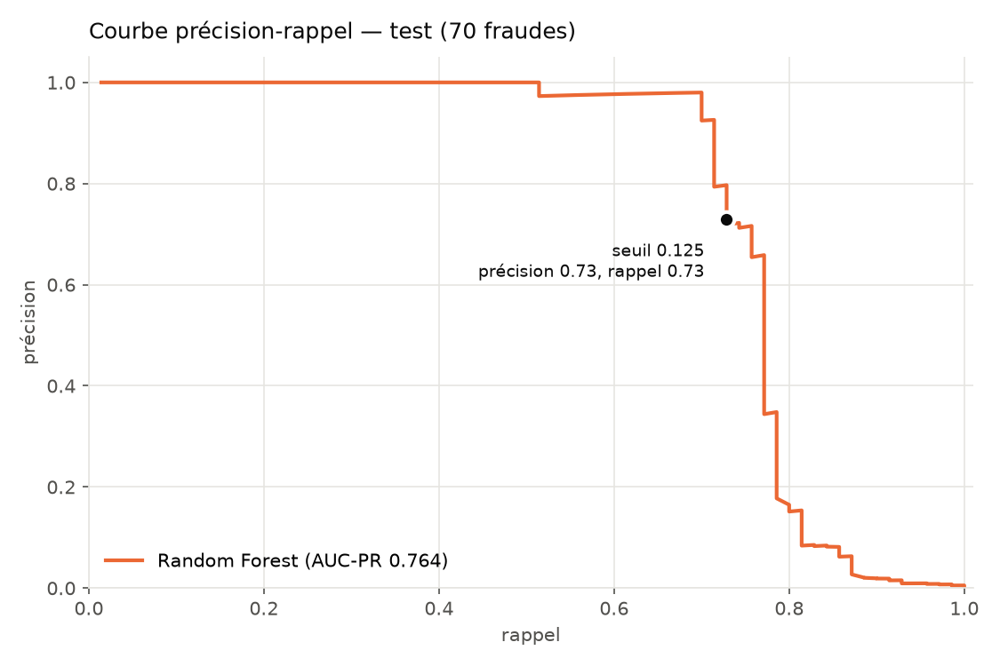
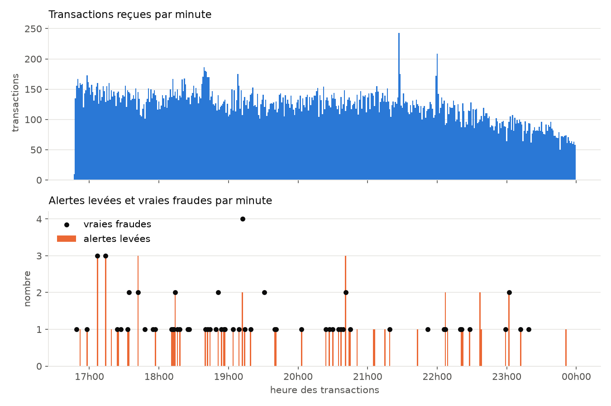
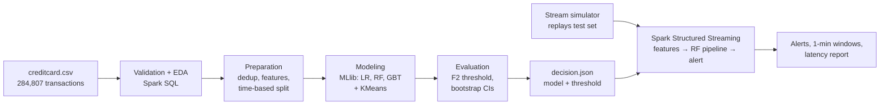

# Real-Time Credit Card Fraud Detection with Apache Spark

End-to-end Big Data project: a fraud detection model trained with **Spark MLlib** on real
credit card transactions, then deployed on a continuous stream of transactions with
**Spark Structured Streaming**, fully containerised with **Docker**.

The project follows the **CRISP-DM** method: one folder per phase, each with its scripts,
its generated outputs (reports, charts) and a README explaining the choices made.

**Stack:** Python · PySpark 4.2 (Spark SQL, MLlib, Structured Streaming) · Docker · pandas · matplotlib

## Key results

| | Result |
|---|---|
| Model | Random Forest (Spark MLlib), chosen on a time-based validation set |
| Test set (never used for any choice) | **51 of 70 frauds detected**, 19 false alarms out of 52,906 transactions |
| Precision / recall | 0.73 / 0.73 (95 % bootstrap interval for recall: 0.62 – 0.82) |
| AUC-PR / AUC-ROC | 0.764 / 0.983 |
| Real-time stream | 52,906 transactions scored, **identical decisions to the batch evaluation** for every transaction |
| Streaming latency | median **1.8 s**, 95th percentile 2.0 s (2-second micro-batches) |
| Reproducibility | Same results on different machines (fixed Spark parallelism, deterministic data order) |

<p>
  
  
</p>

## Architecture



## Data

[Credit Card Fraud Detection](https://www.kaggle.com/datasets/mlg-ulb/creditcardfraud)
(Worldline and the Machine Learning Group of ULB): 284,807 real transactions by European
cardholders over two days in September 2013, of which **492 are frauds (0.17 %)**.
Features `V1`–`V28` are PCA components (anonymised); `Time`, `Amount` and `Class` are raw.

The dataset is **not included** in this repository. Download it from Kaggle and place
`creditcard.csv` in `data/archive/`. If you use it, please cite the authors as requested on
the Kaggle page, e.g. A. Dal Pozzolo, O. Caelen, R. A. Johnson, G. Bontempi,
*Calibrating Probability with Undersampling for Unbalanced Classification*, IEEE CIDM 2015.

## Project structure

| Phase | Folder | What it does |
|---|---|---|
| 1. Business understanding | `1_business_understanding/` | Problem, goals, success metrics (AUC-PR, recall, precision, latency) |
| 2. Data understanding | `2_data_understanding/` | Schema validation against the official counts, EDA with Spark SQL (4 charts) |
| 3. Data preparation | `3_data_preparation/` | Duplicate removal, `hour` and `log_amount` features, **time-based** 70/15/15 split |
| 4. Modeling | `4_modeling/` | MLlib pipelines (Logistic Regression, Random Forest, GBT), class weights, KMeans anomaly detection |
| 5. Evaluation | `5_evaluation/` | Decision threshold maximising F2 on validation, single final test evaluation, bootstrap confidence intervals, error analysis |
| 6. Deployment | `6_deployment/` | Stream simulator, Spark Structured Streaming detection, end-to-end consistency check |

Shared settings are in `config.py`. Each phase folder contains an `outputs/` directory with
the generated reports and figures, so results can be read without running anything.

> The detailed phase READMEs and generated reports are written in **French** (the project was
> first produced as a university assignment). Section titles, tables and figures are easy to follow.

## Notable design choices

- **Time-based split, no random shuffling.** Models are trained on the past and evaluated on the
  future, as in production. `CrossValidator` is not used because it would shuffle rows; settings are
  compared on the validation period instead.
- **AUC-PR, not accuracy.** With 1 fraud for 577 transactions, predicting "never fraud" gives
  99.83 % accuracy. Model selection uses AUC-PR; the alert threshold maximises **F2**
  (a missed fraud counts twice as much as a false alarm).
- **Class weights were tested and rejected.** They did not improve AUC-PR for any model and
  strongly hurt GBT; the imbalance is handled by the threshold choice instead.
- **Unsupervised anomaly detection, reported honestly.** Without labels, KMeans isolates about half
  of the frauds in small clusters, but its anomaly score is far weaker than the Random Forest and finds
  no fraud the Random Forest misses: unusual is not the same as fraudulent.
- **Test set touched once.** Model, settings and threshold are all chosen on validation; the test
  score is an unbiased estimate, with bootstrap confidence intervals (only 70 test frauds).
- **Streaming = batch.** The streaming job reuses the exact saved MLlib pipeline and threshold; a
  report re-scores every streamed transaction in batch and checks that the decisions are identical.
  True labels never enter the stream.
- **Reproducibility.** Random Forest, GBT and KMeans depend on how Spark partitions the data; a
  fixed number of Spark threads and deterministic file ordering give identical results across machines.
- **Docker volume for streaming files.** On Windows, the shared host folder made Spark fall behind
  (median latency 4.1 s, max 16.7 s); moving the stream's small files to a Docker volume brought it
  to 1.8 s median, 2.8 s max.

## How to run

Requirements: Docker Desktop. The image provides Python 3.11, Java 17 and PySpark; the project
folder is shared with the container, so outputs appear directly in the repository folders.

```bash
# Build the image (once)
docker compose build

# Batch pipeline, phases 2 to 5 (run from the repository root)
docker compose run --rm --service-ports spark python 2_data_understanding/01_load_and_validate.py
docker compose run --rm --service-ports spark python 2_data_understanding/02_eda.py
docker compose run --rm --service-ports spark python 3_data_preparation/01_prepare.py
docker compose run --rm --service-ports spark python 4_modeling/01_train_supervised.py
docker compose run --rm --service-ports spark python 4_modeling/02_train_kmeans.py
docker compose run --rm --service-ports spark python 5_evaluation/01_choose_threshold.py
docker compose run --rm --service-ports spark python 5_evaluation/02_evaluate_test.py

# Real-time detection, phase 6 (two terminals)
docker compose run --rm --service-ports spark python 6_deployment/02_stream_detection.py   # terminal 1
docker compose run --rm spark python 6_deployment/01_stream_simulator.py                   # terminal 2
docker compose run --rm spark python 6_deployment/03_stream_report.py                      # when finished
```

While a script runs, the Spark UI is available at http://localhost:4040. The stream replays the
7.2 hours of the test set at ×60 speed (about 7 minutes); add `--speed 600` to the simulator for a
45-second demo.

Without Docker: Python 3.10+, Java 17 or 21, then `pip install -r requirements.txt` and the same
`python ...` commands (on Windows, Spark also needs `winutils.exe` and `HADOOP_HOME`).

## Limitations

- Only two days of data: validation and test contain no night hours, where fraud is most frequent.
- 61 validation and 70 test frauds: metrics carry wide uncertainty (hence the confidence intervals).
- The stream source is a watched folder; a Kafka source is planned as the next step.

## License

Code released under the [MIT License](LICENSE). The dataset is not covered by this license; see
its Kaggle page for its own terms.
